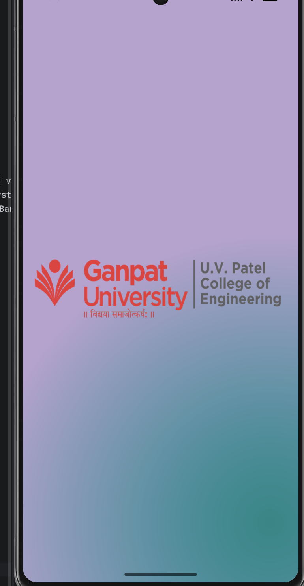
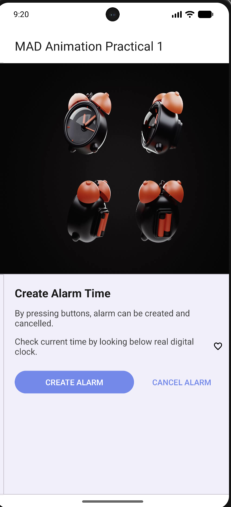

# MAD Practical 6 – Frame by Frame Animation & Splash Screen

## 📱 AIM

Create an Android application to demonstrate **Frame by Frame Animation** and a **Splash Screen** to demonstrate **Tween (Twin) Animation**.

---

## 📖 Study

The following Android concepts are demonstrated in this practical:

* ImageView
* Frame by Frame Animation
* Tween Animation
* Immersive Mode
* Display Edge-to-Edge
* Splash Screen
* AnimationDrawable
* `onWindowFocusChanged()` method
* `AnimationUtils` class
* `loadAnimation()` method
* `setAnimationListener()` method
* `overridePendingTransition()` method
* `finish()` method
* `anim` folder in `res`
* Converting SVG files into XML drawable resources

---

## 🎯 Objectives

The main objectives of this practical are:

1. To understand **Frame by Frame Animation** in Android.
2. To create animation using multiple drawable frames.
3. To understand and implement a **Splash Screen**.
4. To demonstrate **Tween Animation**.
5. To learn how to use animation resources inside the `res/anim` folder.
6. To understand the use of `AnimationDrawable`.
7. To understand Android immersive and edge-to-edge display features.
8. To navigate from the Splash Screen to the main activity.

---

## 🎞️ Frame by Frame Animation

Frame by Frame Animation displays a sequence of images one after another to create the appearance of movement.

Android provides the `AnimationDrawable` class for implementing frame-by-frame animation.

### Basic Working

```text
Image 1 → Image 2 → Image 3 → Image 4 → Image 5
                    ↓
              Continuous Animation
```

Each image acts as a separate frame. When the frames are displayed quickly one after another, they create an animation effect.

### AnimationDrawable

`AnimationDrawable` is used to control frame-by-frame animations.

Example:

```kotlin
val animation = imageView.drawable as AnimationDrawable
animation.start()
```

---

## ✨ Tween Animation

Tween animation creates movement or transformation between the starting and ending states of a view.

Common Tween Animation types include:

* Alpha Animation
* Scale Animation
* Rotate Animation
* Translate Animation

For example, a view can gradually:

```text
Start Position
      ↓
   Move / Scale / Rotate
      ↓
End Position
```

Animation resources can be stored inside:

```text
res/
 └── anim/
      ├── fade_in.xml
      ├── scale.xml
      ├── rotate.xml
      └── translate.xml
```

---

## 🚀 Splash Screen

A Splash Screen is the initial screen displayed when an Android application starts.

It is generally used to:

* Display the application logo.
* Provide a smooth startup experience.
* Perform initial application setup.
* Introduce the application before opening the main screen.

### Flow of the Application

```text
        START
          ↓
    Splash Screen
          ↓
      Animation
          ↓
   Animation Complete
          ↓
     Main Activity
          ↓
         END
```

---

## 🛠️ Technologies Used

| Technology        | Purpose                    |
| ----------------- | -------------------------- |
| Android Studio    | Development Environment    |
| Kotlin            | Programming Language       |
| XML               | UI and Animation Resources |
| ImageView         | Display Images             |
| AnimationDrawable | Frame Animation            |
| AnimationUtils    | Load Animation             |
| Splash Screen     | Application Startup Screen |
| Tween Animation   | View Animation             |

---

## 📂 Project Structure

A typical project structure used for this practical is:

```text
24012011037_MAD_Practical-6/
│
├── app/
│   └── src/
│       └── main/
│           ├── java/
│           │   └── MainActivity.kt
│           │
│           ├── res/
│           │   ├── drawable/
│           │   ├── mipmap/
│           │   ├── anim/
│           │   ├── layout/
│           │   └── values/
│           │
│           └── AndroidManifest.xml
│
├── build.gradle.kts
├── settings.gradle.kts
└── README.md
```

---

## 🔑 Important Methods and Classes

### 1. `AnimationDrawable`

Used to create and control frame-by-frame animations.

```kotlin
AnimationDrawable
```

### 2. `AnimationUtils`

Used to load animation resources from the `res/anim` folder.

```kotlin
AnimationUtils.loadAnimation()
```

### 3. `loadAnimation()`

Loads an animation XML resource.

```kotlin
val animation = AnimationUtils.loadAnimation(
    this,
    R.anim.animation_name
)
```

### 4. `setAnimationListener()`

Used to detect animation events such as:

* Animation Started
* Animation Repeated
* Animation Ended

Example:

```kotlin
animation.setAnimationListener(object : Animation.AnimationListener {

    override fun onAnimationStart(animation: Animation?) {
    }

    override fun onAnimationEnd(animation: Animation?) {
    }

    override fun onAnimationRepeat(animation: Animation?) {
    }
})
```

### 5. `finish()`

Used to close the current Activity.

```kotlin
finish()
```

It can be used after the Splash Screen animation finishes so that the user cannot return to the Splash Screen using the Back button.

### 6. `overridePendingTransition()`

Used to apply a transition animation when switching between activities.

```kotlin
overridePendingTransition(
    R.anim.fade_in,
    R.anim.fade_out
)
```

### 7. `onWindowFocusChanged()`

This method is called when the Activity gains or loses window focus.

It can be used to control UI behavior such as immersive mode.

---

## 📱 Application Features

### Frame Animation

The application displays multiple images sequentially to create a frame-by-frame animation effect.

### Splash Screen

The application starts with a Splash Screen containing an animation before navigating to the main screen.

### Tween Animation

The application demonstrates animation effects such as movement, scaling, rotation, or fading.

### Immersive Mode

The application can provide a fullscreen experience by hiding system UI elements.

### Edge-to-Edge Display

The application supports displaying content across the available screen area.

---

## ▶️ How to Run the Project

1. Clone or download the repository.
2. Open **Android Studio**.
3. Select **Open**.
4. Select the project folder:

   ```text
   24012011037_MAD_Practical-6
   ```
5. Allow Gradle to sync.
6. Connect an Android device or start an Android Emulator.
7. Click **Run ▶**.
8. The application will launch with the Splash Screen and animation.

---

## 🧪 Expected Output

When the application is executed:

1. The **Splash Screen** appears.
2. The animation starts.
3. Frame-by-frame / Tween animation is demonstrated.
4. After the animation completes, the application moves to the **Main Activity**.
5. The main screen of the application is displayed.

---

## 📸 Screenshots


<table>
  <tr>
    <td></td>
    <td></td>
  </tr>
</table>
---

## 📚 Learning Outcomes

After completing this practical, we understand:

* How frame-by-frame animation works.
* How to use `AnimationDrawable`.
* How to create a Splash Screen.
* How to create and use Tween Animations.
* How to create animation XML files.
* How to load animations using `AnimationUtils`.
* How to use animation listeners.
* How to transition between Android Activities.
* How to implement immersive and edge-to-edge display.
* How to use drawable resources and animation resources in Android.

---

## Conclusion

The Android application successfully demonstrates **Frame by Frame Animation**, **Splash Screen**, and **Tween Animation**. This practical provides an understanding of Android animation techniques, animation resources, Activity transitions, and modern Android screen-display features.

---
